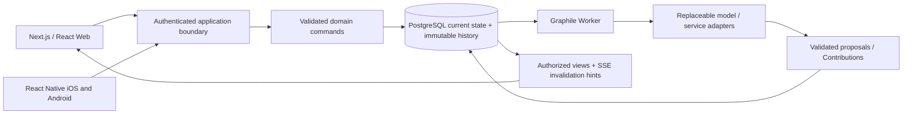

# RIMIAM


**A conversation-first collaborative workspace with persistent context and explicit human control over AI-generated work.**

People and Emme work in a shared Conversation. The server preserves sources, accepted information, decisions, tasks and work results as distinct, inspectable records. A model can propose a change; it cannot turn its interpretation into another person's consent or permission to act.

**Web beta · 21 November 2026.** The latest recorded Railway release runs the Web app and worker through database migration 075. The Home screen opens with conversations, followed by personal tools and the daily agenda. Two test accounts have exchanged messages, received an invitation by email and checked a contextual reply from Emme. [Open the beta](https://rimiam-chat-web-production.up.railway.app/) · [Deployment record](docs/development/RAILWAY_DEPLOYMENT.md#current-setup).

**In this checkout.** The next release candidate adds a direct route to the daily agenda and keeps workspace navigation available in personal tools. In a populated space, you can browse shared screenshots, files and links by date or type and return to the original message. These changes have been tested locally. The React Native apps can be built for iOS and Android. Distribution to testers and physical-device acceptance are pending. [Current status and evidence](docs/development/STATUS.md) · [Technical case study](docs/development/PORTFOLIO_CASE_STUDY.md).

## What you can explore

Start with the [Web workflow guide](docs/development/WEB_WORKFLOWS.md) for a two-person walkthrough and links from each feature to its implementation and verification. Local Web, iOS and Android builds offer [Italian and English](docs/development/INTERFACE_LANGUAGES.md). Use `/h` in a workspace conversation to [draw and attach a sketch](docs/development/RICH_INPUTS.md#draw-in-a-workspace-conversation).

| Area                  | Implemented behavior                                                                                        | Verification boundary                                                                      |
| --------------------- | ----------------------------------------------------------------------------------------------------------- | ------------------------------------------------------------------------------------------ |
| Shared workspace      | Separate accounts, invitations, retained Conversation, Goal, membership and scoped authority                | Real local PostgreSQL/auth/API and selected two-account browser scenarios                  |
| Context and proposals | Attributed statements, Accepted Information, source references, versioned corrections and explicit adoption | Deterministic domain checks; real-model judgment needs live acceptance                     |
| Tasks and Active Work | Accepted responsibility, follow-up, shared steering, pause/stop/resume and inspectable Contributions        | Local command/worker/browser checks; model usefulness is not implied                       |
| Sources and outputs   | Documents, research, provenance and versioned Artifacts                                                     | Local extraction and provider-double tests; service-dependent paths need activation        |
| Optional integrations | Google and Microsoft calendars and mailboxes, transcription, voice and human audio calls                    | Implementation present; configuration, permissions and live/device validation are separate |

The hosted app works in a browser on desktop, tablet and smartphone. To add the Web beta to an iPhone Home Screen and test notifications, follow the [physical iPhone guide](docs/development/PROVA_IPHONE.md).

## Architecture in brief



- **TypeScript / Node.js modular monolith:** Web routes and a standalone API reuse the same application modules and versioned contracts. Exact versions are pinned in [package.json](package.json) and its lockfile.
- **PostgreSQL is authoritative:** normal reads use materialized current state; source, version and provenance history is retained. The application does not reconstruct current state by replaying model output.
- **Commands own effects:** current access, authority, expected versions and idempotency are validated server-side. The browser's local command journal helps recover uncertain outcomes without inventing success.
- **AI output is untrusted input:** structured adapters validate output; retrieval follows Minimum Sufficient Context. Active Work produces Contributions, with separate governed paths for adoption or consequential effects.
- **Asynchronous work is durable:** Graphile Worker uses the existing database. SSE tells clients to refresh authorized views; it is not a domain ledger or proof of worker health.

Start at [CODEMAP](docs/development/CODEMAP.md) for verified code entry points and the topic-to-ADR index. See [the approved decisions](docs/decisions/) for rationale and invariants.

## Run locally

Requirements: **Node.js 24.x**, npm and PostgreSQL. The supplied Docker Compose file runs PostgreSQL locally; Docker is optional if you provide a compatible local database yourself.

From a checkout, with Docker running:

```sh
npm ci
npm run setup:env
npm run db:up
npm run db:migrate
npm run dev
```

In a second terminal:

```sh
npm run worker
```

Open [http://127.0.0.1:3000](http://127.0.0.1:3000). Keep this hostname consistent for cookies and origin checks. The worker handles asynchronous processing; starting the Web process alone is insufficient.

`setup:env` creates `.env` from [.env.example](.env.example), generates a random local authentication secret and preserves an existing file. The example database credentials are **local-only**. Compose binds PostgreSQL to `127.0.0.1:54329` and preserves data in a named volume. The migration runner checks previously applied migration contents; do not edit an applied SQL file.

Stop application terminals with Ctrl-C and use `docker compose stop` to stop the database without deleting its volume. Do not use a production database for local setup or tests.

### Run the React Native app

The iOS and Android apps share the TypeScript frontend in [mobile](mobile/). Expo generates each platform project locally from [app.config.ts](mobile/app.config.ts) when you build it.

Keep the local server running. From the repository root, install the mobile dependencies with `npm ci --prefix mobile`. Run `npm --prefix mobile run ios` for the iOS simulator (macOS, Xcode and CocoaPods), or `npm --prefix mobile run android` for the Android emulator (Android Studio, Android SDK and JDK 17). At sign-in, enter `http://127.0.0.1:3000` on the iOS simulator or `http://10.0.2.2:3000` on the standard Android emulator. See [mobile setup and checks](docs/development/MULTICLIENT.md#run-the-mobile-app) for the two-account fixture and provider setup.

### Try two accounts

1. Register with a password of at least 12 characters. With the default configuration, use [/local-mail](http://127.0.0.1:3000/local-mail) in that same browser session to verify the account. No external email is sent. The viewer is restricted to local development.
2. Create a Workspace and send a message. A Goal and adherence are explicit acts, separate from membership.
3. Select **Invita** in the chat header and enter the second person's email. In a separate browser profile, sign in with that verified address. Open the incoming invitation, review the shared-history notice and accept. The personal link also works, including when email delivery was not requested.
4. Try `/guida` in the local Web composer to explore the available commands. With a real model configured, use **Chiedi a Emme** to request a reply. Inspect the sources and proposed result before adopting anything.

Password recovery and verification resend use the same local-mail mechanism. Real external delivery requires a configured mail provider.

<a id="local-document-parsers"></a>

### Optional local document extraction

PDF/DOCX extraction uses Python and the pinned packages in [requirements-documents.txt](requirements-documents.txt). The previously verified local Python runtime is 3.13:

```sh
python3.13 -m venv .venv
.venv/bin/pip install -r requirements-documents.txt
```

Set `DOCUMENT_PYTHON_PATH` in `.env` to the absolute path of `.venv/bin/python` and restart the worker. The Docker runtime has its own Python environment; it does not depend on a developer's tools.

## Configure real AI and services

A fresh environment intentionally has no model, research or transcription service enabled. Missing configuration is reported as unavailable; production does not fall back to a fabricated response. Deterministic providers belong to tests only.

For text/analysis with OpenAI, configure the server-side `AI_MODE=openai`, `OPENAI_API_KEY` and `AI_MODEL` using a compatible structured-output model. Anthropic and Ollama adapters are alternatives; there is no automatic cross-provider fallback. Never put provider keys in client-side variables or source control.

**Self-hosting with Google.** Register your own Google Cloud project and two Web OAuth clients for sign-in and Calendar. Each installation uses its own domain and credentials. Members choose separately whether to connect a calendar. Microsoft sign-in is optional and uses its own Entra registration. [Google self-hosting setup](docs/development/GOOGLE_INTEGRATIONS.md#self-hosting-with-google) · [Microsoft sign-in](docs/development/MICROSOFT_SIGN_IN.md).

Mail delivery, Brave research, transcription, personal mailbox access and LiveKit calling have separate configuration and consent requirements. Recording consent does not authorize AI analysis or adoption. Existing queued work can incur usage after a provider or worker is activated. [Mailbox setup and live verification](docs/development/DEPLOY_EXTERNAL_SERVICES.md#caselle-personali-gmail-e-outlook).

Use [DEPLOY_EXTERNAL_SERVICES](docs/development/DEPLOY_EXTERNAL_SERVICES.md) for configuration, costs requiring verification, required consents and exact live checks. Historical deployment notes are evidence of past actions, not proof that a service or credential still works today.

Before reactivating a worker, follow the [release runbook](docs/development/RELEASE_RUNBOOK.md). `npm run release:preflight` collects read-only local migration/queue/domain aggregates without calling providers; it does not authorize activation or certify that queued work is safe to resume.

## Verify a change

Keep the local database running and install the [document tools](#local-document-parsers) for the full suite. The PDF preview tests also require `pdftoppm` on your PATH, provided by `poppler-utils` on Debian and Ubuntu or `poppler` on macOS with Homebrew.

```sh
npm run test:setup
npm test -- tests/sources-research.test.ts
npm run typecheck
```

For a focused browser flow:

```sh
npx playwright install chromium
npm run test:e2e -- tests/e2e/slice01.spec.ts
```

At a release milestone:

```sh
npm run check
npm run test:e2e
npm run build
npm run build:backend
```

`check` runs TypeScript, lint, formatting and tests. Domain tests use `miriam_test`; the E2E harness creates/migrates `miriam_e2e`, runs Web and a test worker on port 3100 and stops those processes afterward. External-provider doubles and deliberate network faults test recovery deterministically; they do not certify real provider behavior. Browser viewport checks do not establish native-app or physical-device acceptance.

Tests require permission to create the separate local test databases. Some account-recovery checks intentionally respect rate-limit windows. Follow [CONTRIBUTING](CONTRIBUTING.md) for the targeted-development and milestone-verification workflow.

The [Web quality workflow](.github/workflows/web-ci.yml) defines isolated database checks, a bounded Chromium smoke and Docker runtime validation without production credentials. Its presence is not evidence of a successful GitHub Actions run; remote CI and deployment results must be recorded separately.

## Documentation and project history

| Need                                                 | Start here                                                                  |
| ---------------------------------------------------- | --------------------------------------------------------------------------- |
| Current implementation, evidence and next checkpoint | [STATUS](docs/development/STATUS.md)                                        |
| Code navigation and impact analysis                  | [CODEMAP](docs/development/CODEMAP.md)                                      |
| Canonical product semantics                          | [MVP specification](docs/product/MVP_SPEC_v0.1.md), [ADRs](docs/decisions/) |
| Engineering decisions demonstrated by the code       | [Technical case study](docs/development/PORTFOLIO_CASE_STUDY.md)            |
| Setup, deployment and recovery                       | [External services guide](docs/development/DEPLOY_EXTERNAL_SERVICES.md)     |
| Contribution and security reporting                  | [CONTRIBUTING](CONTRIBUTING.md), [SECURITY](SECURITY.md)                    |

**RIMIAM** is the workspace. **Emme** is the AI you talk to in its chat. **Allinagent** appears in historical discovery; **MIRIAM** remains in paths and technical identifiers. The canonical filename `MVP_SPEC_v0.1.md` is historical and stable, not the current application version. Later drafts and architecture proposals do not override approved ADRs. Product documentation intentionally retains its original language and decision provenance.

## Release boundaries and license

The two-account beta smoke check covers a limited conversation and email delivery. Broader real-model collaboration, backup/restore and physical-device behavior still need live verification. Native distribution and advanced integrations are not prerequisites for reviewing the Web engineering work. Published beta-use rules do not replace the operator's privacy, retention and deletion arrangements.

The hosted beta currently limits Google Calendar connections to approved OAuth testers. Microsoft activation is deferred. Operators can use the [manual Web deployment guide](docs/development/DEPLOY_WEB_MANUALE.md) for the local release candidate. [Release checkpoint](docs/development/WEB_RELEASE.md) · [Phase 2 backlog](docs/development/WEB_FASE_2.md).

Licensed under the [MIT License](LICENSE). Third-party dependencies retain their respective licenses.
