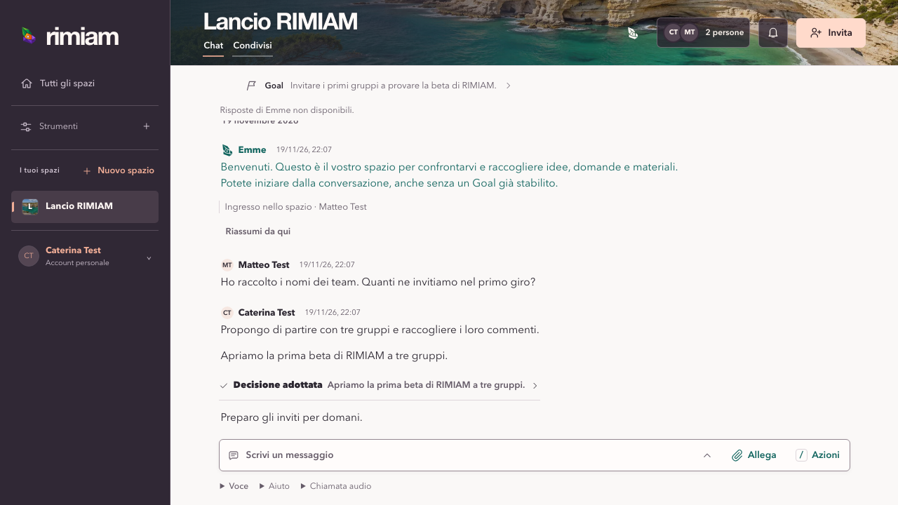
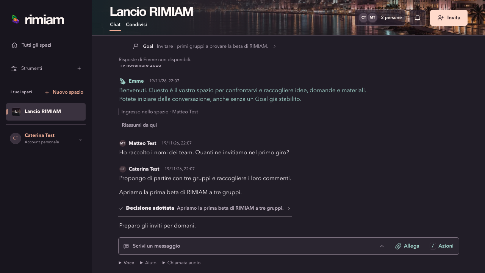
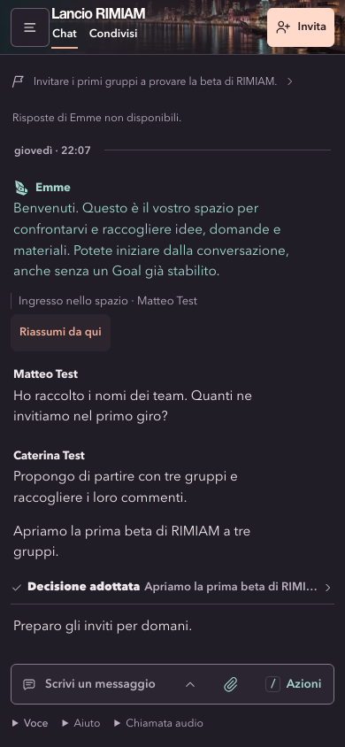

# Conversazione Web verificata

Catture della Web app compilata per produzione, eseguita in locale con account e spazio di prova. Il gruppo “Lancio RIMIAM” contiene due partecipanti e una decisione effettivamente adottata. La riga della decisione apre il suo atto, con il ritorno alla posizione di lettura. Il provider esterno è disattivato.

| Desktop chiaro · 1280 × 720 | Stessa conversazione in scuro · 1280 × 720 | Web stretto · 390 × 844 |
| --- | --- | --- |
|  |  |  |

La terza cattura usa un viewport da telefono nel browser desktop. Il percorso è riproducibile con il [test di navigazione della decisione](../../../../../tests/e2e/timeline-decisions.spec.ts). Le [fonti degli asset editoriali](../../../BRAND.md#current-web-identity) sono documentate separatamente.
