# RIMIAM Web su schermi diversi

Lo stesso spazio di prova, «Lancio RIMIAM», con dodici messaggi di due persone e un documento condiviso. Sono catture dell’app locale. I collegamenti aprono le immagini alla risoluzione originale.

| Percorso | Chromium · chiaro | Firefox · scuro |
| --- | --- | --- |
| **Home**, 390 × 844. La riga dello spazio raccoglie nome, non letti e anteprima dell’ultimo messaggio. |  |  |
| **Home → Personale → Configura Emme**, 390 × 844. Il campo «Modello o agente» e il nome sono visibili all’apertura. La destinazione personale è indicata sotto il titolo. | [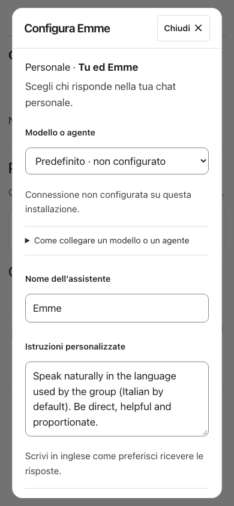](chromium-390x844-settings.webp) | [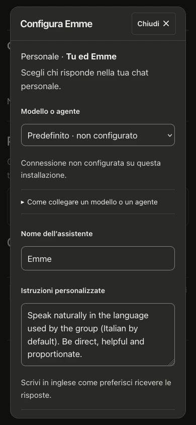](firefox-390x844-settings.webp) |
| **Chat**, 390 × 844. Gli interventi attribuiti alle due persone si leggono in sequenza; «Attività» lascia libero lo spazio per i messaggi. | [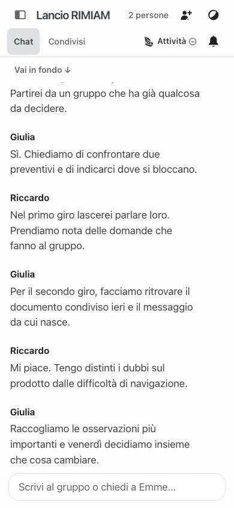](chromium-390x844-chat.webp) | [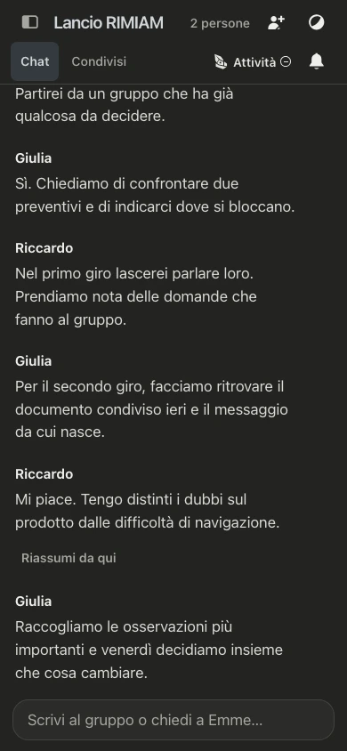](firefox-390x844-chat.webp) |
| **Chat con bozza**, 390 × 440. Una finestra bassa mette alla prova lo spazio per testo e comandi. | [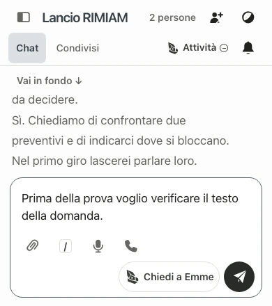](chromium-390x440-composer.webp) | [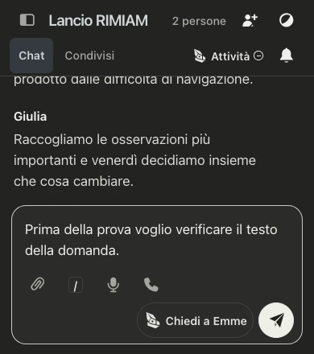](firefox-390x440-composer.webp) |
| **Chat → Condivisi**, 320 × 568. Sotto ricerca e filtri compare il file appena condiviso. | [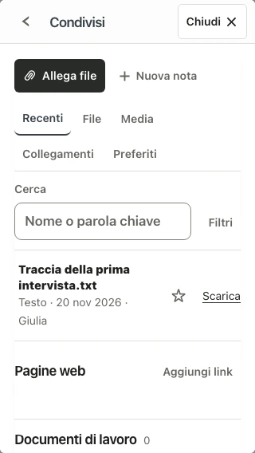](chromium-320x568-shared.webp) | [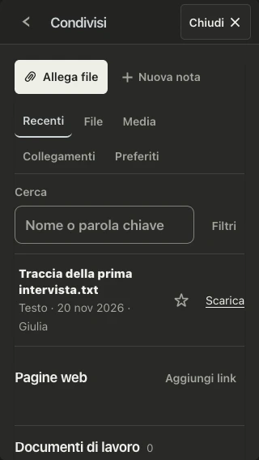](firefox-320x568-shared.webp) |

| Condivisi prima · 320 × 568 | Home su tablet · 768 × 1024 | Chat su computer · 1366 × 768 |
| --- | --- | --- |
| [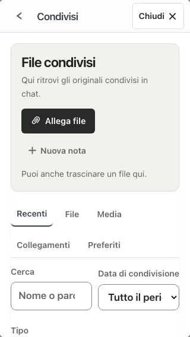](chromium-320x568-shared-before.webp) | [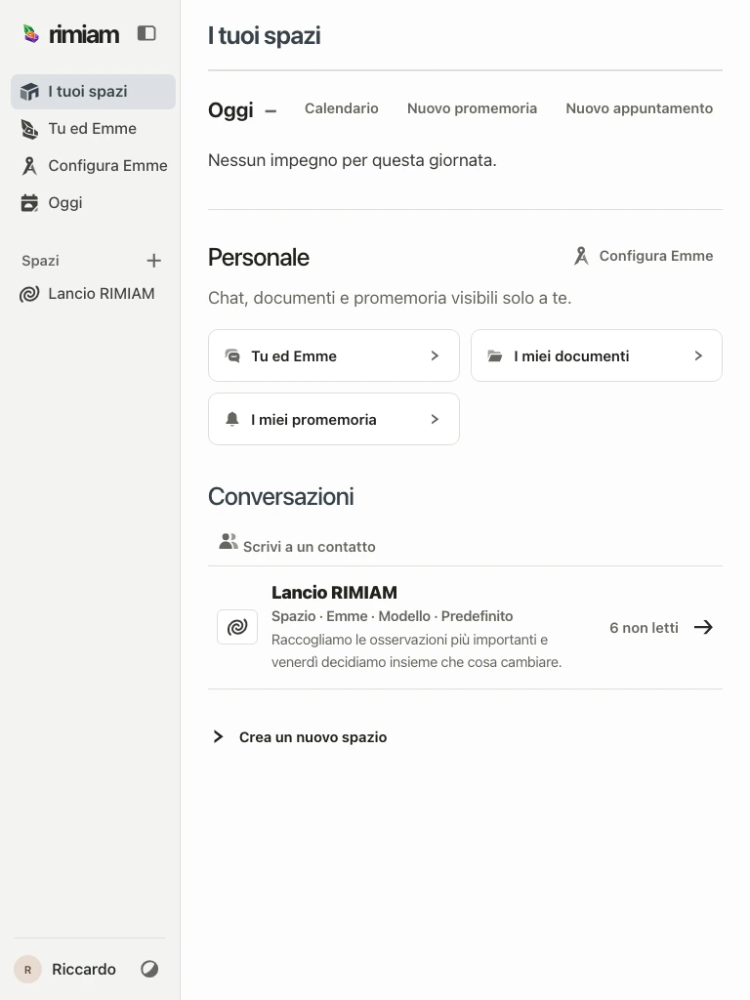](chromium-768x1024-home.webp) | [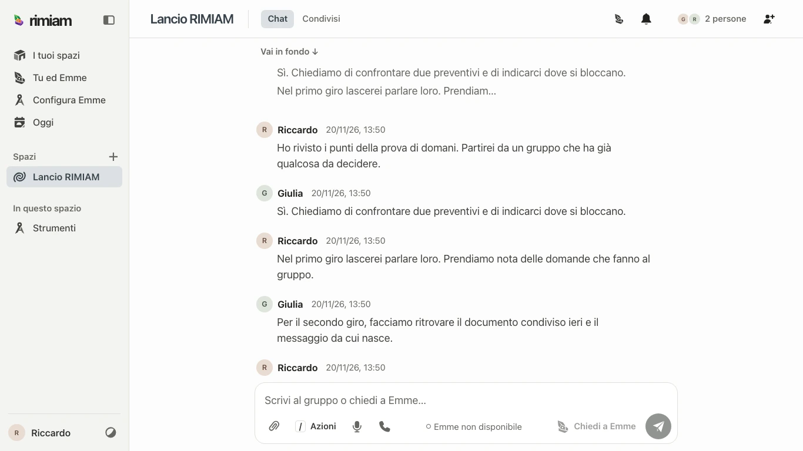](chromium-1366x768-chat.webp) |

## Menu del profilo

| Telefono · 390 × 844 | Tablet · 768 × 844 |
| --- | --- |
| [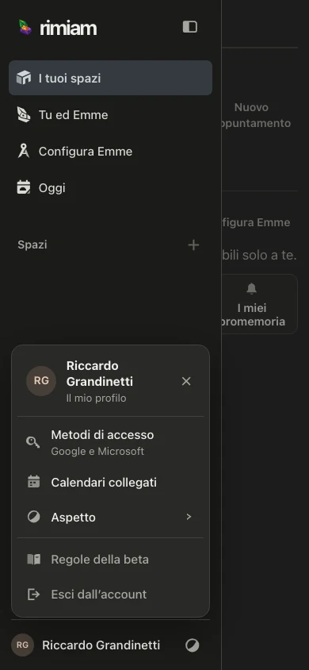](account-menu-390.webp) | [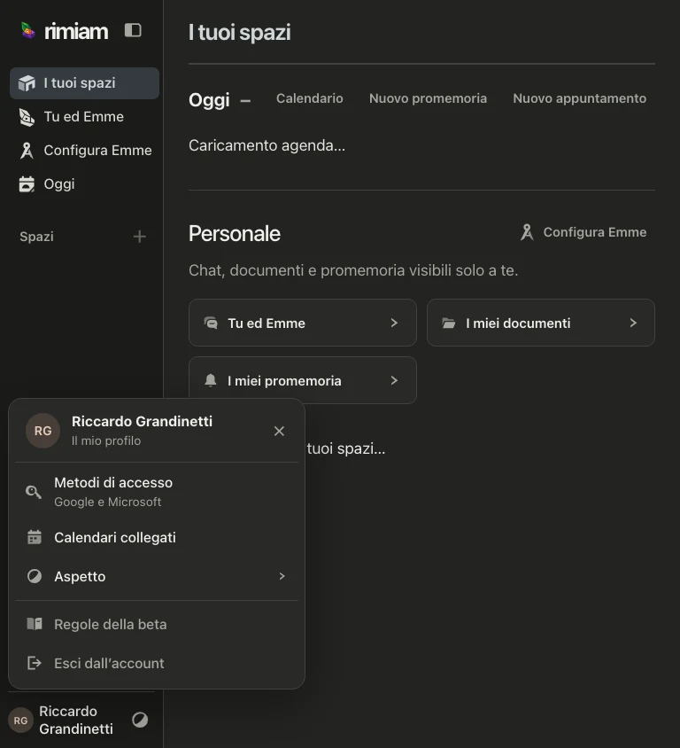](account-menu-768.webp) |

**Metodi di accesso** porta alle identità Google e Microsoft. **Calendari collegati** apre le autorizzazioni del calendario. La foto e il telefono si modificano toccando il proprio nome. I controlli per tema e colore si aprono con **Aspetto**. [Percorsi verificati](../../../../tests/e2e/appearance-navigation.spec.ts).

## Cosa cambia nell’uso

- **Home.** Sul telefono l’anteprima dell’ultimo messaggio usa la larghezza della riga. «Oggi» e «Personale» occupano ancora una parte importante della prima schermata quando l’agenda è vuota. La comodità di questa priorità va valutata con chi rientra per leggere un messaggio.
- **Configura Emme.** Dal pannello personale si sceglie fra le connessioni disponibili e si può passare agli spazi gestiti. Su uno schermo corto si scorre per raggiungere il salvataggio. Il comando di chiusura è in testata.
- **Condivisi.** Prima della modifica, sul telefono da 320 px intestazioni e filtri occupavano la prima schermata. Ora ricerca e filtri sono affiancati e il primo file si vede all’apertura. Le schede possono distribuirsi su due righe.
- **Chat.** L’input ha spazio per il testo anche con i comandi aperti. Quando l’altezza disponibile scende a 440 px, si vedono meno messaggi e l’invio resta raggiungibile.

La prova usa due account sintetici e un database locale. Le sette finestre selezionate misurano 320 × 568, 360 × 640, 390 × 844, 430 × 932, 768 × 1024, 1366 × 768 e 390 × 440 px. La finestra bassa simula lo spazio ridotto durante la scrittura. Sul simulatore iPhone 13 Pro abbiamo inoltre verificato i due invii con la tastiera di Safari aperta. [Schermate in verticale e orizzontale, prima e dopo](safari/README.md).

Restano da osservare la tastiera del telefono fisico, il comportamento con le dimensioni del testo personalizzate e il comfort dopo una lunga sessione.

Chromium e Firefox hanno completato 29 rilevazioni ciascuno, con 0 px di scorrimento orizzontale della pagina. Sulle finestre mobili, chiudendo Condivisi entrambi ritrovano la posizione di lettura in chat entro 2 px. Chiudendo Configura Emme, il focus torna al comando che ha aperto il pannello.

[Prova riproducibile](../../../../tests/e2e/assistant-layout-review.spec.ts) · [Verifiche funzionali e limiti della beta](CHECKPOINT.md)
