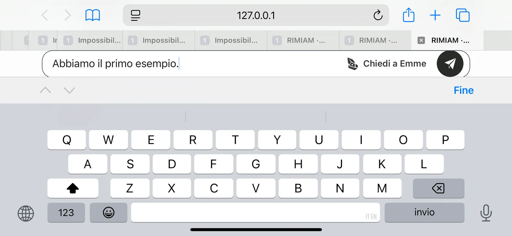

# Safari mobile · Scrivere al gruppo o a Emme

Safari di iOS 18.2 sul simulatore iPhone 13 Pro, tastiera di sistema italiana e due account sintetici nello stesso spazio locale. Le immagini mostrano la Web app con le barre di Safari visibili.

| Verticale, 390 × 844 | Orizzontale, 844 × 390 |
| --- | --- |
|  |  |

In verticale la bozza occupa una riga larga 342 punti. Toccando «Fine» e riaprendo il campo, il testo rimane disponibile. In orizzontale le schede di Safari e la tastiera lasciavano solo 44 punti in altezza: [prima della correzione](orizzontale-prima.webp) si vedeva il testo e «Chiedi a Emme» era irraggiungibile. Ora il campo rimane largo 476 punti, accanto a «Chiedi a Emme» (156 × 44) e all’invio al gruppo (44 × 44). Per leggere la cronologia in questa condizione si chiude la tastiera.

In entrambi gli orientamenti un tocco su ciascuna destinazione ha inviato il messaggio e svuotato la bozza. Il secondo account ha ricevuto i quattro messaggi una volta ciascuno, senza ricaricare la pagina. Nel database locale solo le due domande indirizzate all’assistente contengono `@Emme`. La prova copre il recapito della richiesta; risposta del modello reale e uso su iPhone fisico restano da collaudare.
