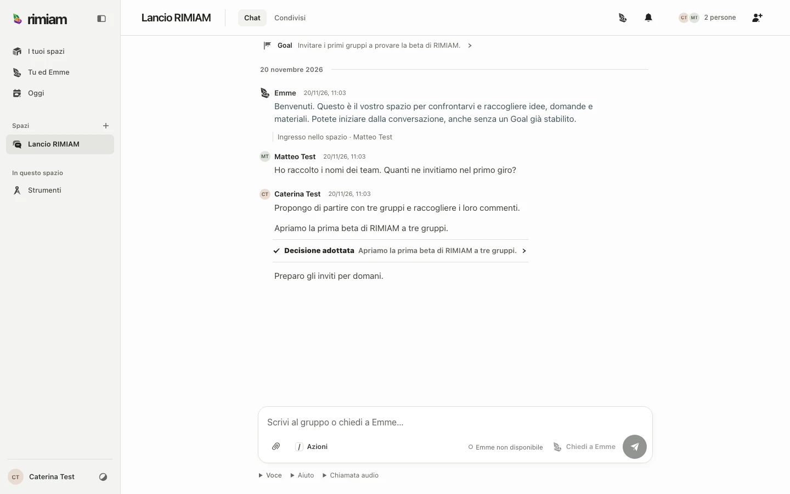
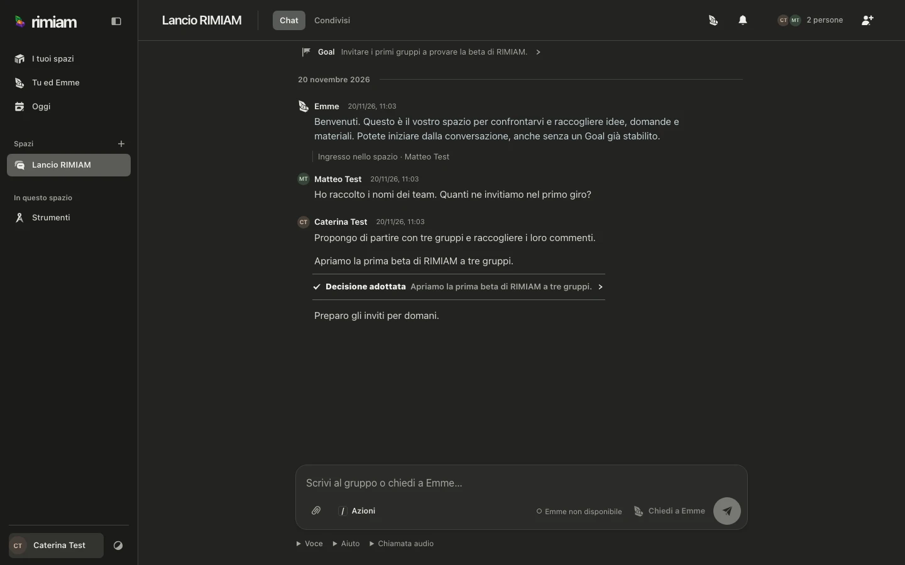
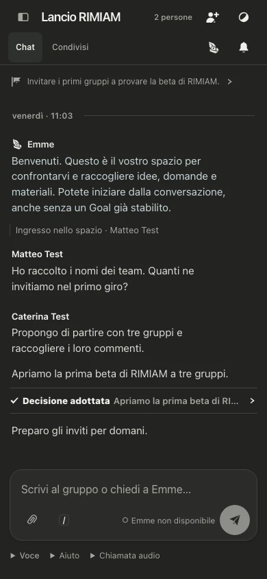
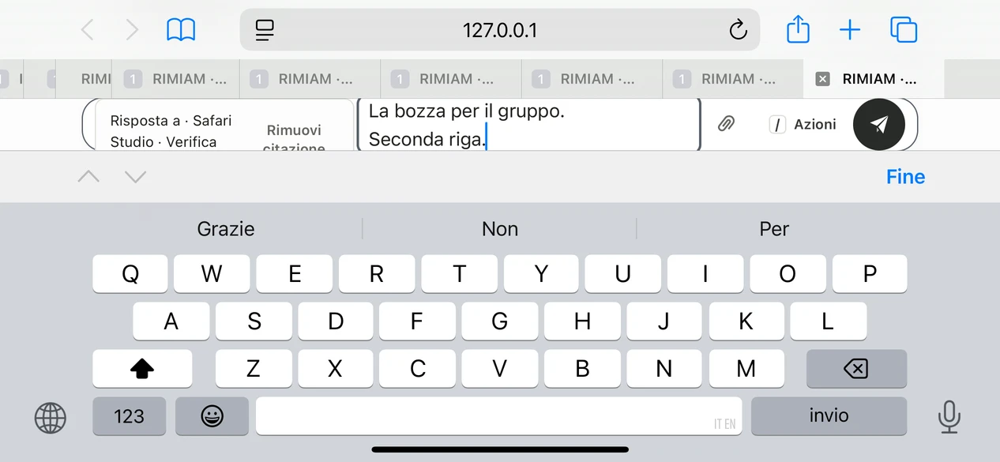

# Studio in the Web app

Local production build of the shared **Lancio RIMIAM** conversation. The two members are test accounts. The decision row opens the adopted decision. The composer displays the actual availability of Emme in this environment, where no external model is configured.

| Desktop · light | Same conversation · dark | Narrow Web · dark |
| --- | --- | --- |
|  |  |  |

[Reproduce the captures](../../../../tests/e2e/timeline-decisions.spec.ts) · [Design reference](../../prototypes/studio/index.html) · [Earlier Web presentation](../2026-11-19-web/verifica/README.md)

## Responsive checks

The [chat regression](../../../../tests/e2e/product-shell.spec.ts) exercises 17 viewport sizes from 320 × 568 to 1920 × 1080, including landscape phones and short laptops. It checks attachment and send controls, preserves a draft through resizing, and hit-tests the last message above the composer. The [tablet regression](../../../../tests/e2e/workspace-header.spec.ts) checks the title and independently tappable header controls with a long space name while Emme is idle or working.

The [media regression](../../../../tests/e2e/chat-attachments.spec.ts) opens a long filename at 320 × 568, closes its preview and returns to the exact thumbnail. Home, Media, date filters and the preview were checked at nine sizes in both themes.

**Safari with its software keyboard.** On the iPhone 13 Pro simulator running iOS 18.2, the keyboard and tab bar in landscape left just one row to write in. Three consecutive messages reached the second test account once each, including a draft reopened after tapping “Fine” and a multiline reply quoting the original message. This capture shows the quoted reply immediately before sending. Verification on physical hardware remains open.

